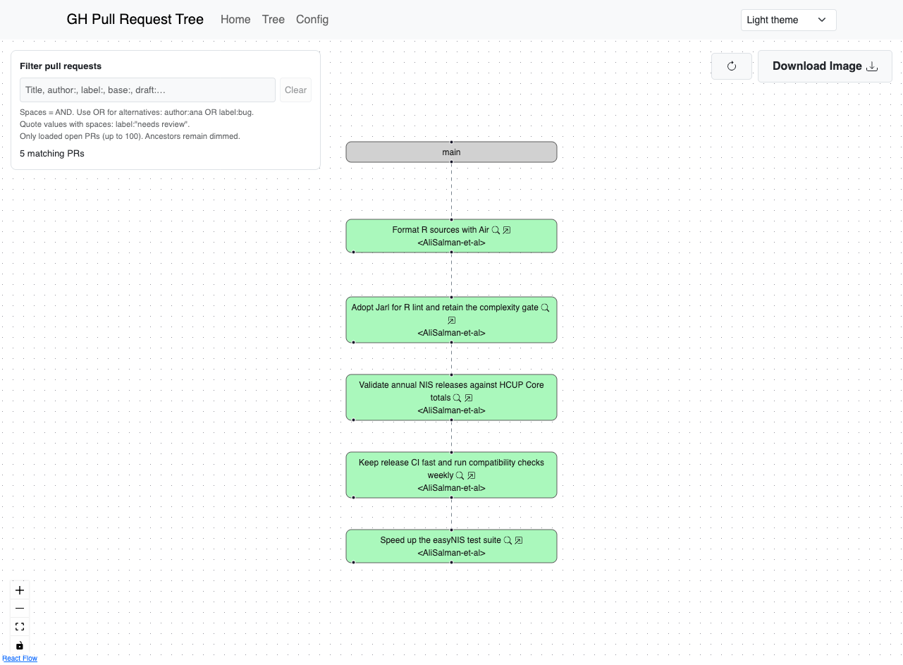

<div align="center">

# 🌳 GitHub PR Tree

**See how your pull requests connect.**

Explore branch dependencies, find the PRs that matter, and share your repository's tree as an SVG.


[Quick start](#-quick-start) · [Filtering](#-filter-your-tree) · [Development](#-development) · [Limitations](#-current-limitations)

<picture>
  <source media="(prefers-color-scheme: dark)" srcset="assets/images/gh_tree_example_dark.png">
  
</picture>

*Thanks to the [easyNIS contributors](https://github.com/MSaadAsif/easyNIS) for the real-world example of stacked pull requests shown above.*

</div>

## ✨ Features

- **Interactive dependency graph** — Understand how open PRs build on one another, with pan and zoom controls.
- **Branch-focused views** — Follow a branch's ancestors and descendants.
- **Live filtering** — Search titles and combine GitHub-style qualifiers, with suggestions as you type.
- **Dependency context** — Matching PRs are highlighted; their ancestors remain visible and dimmed.
- **Mergeability colors** — Green for mergeable PRs, red for conflicts, yellow for unknown status.
- **Repository browsing** — Explore your GitHub user, organizations, and repositories.
- **Cached data + manual refresh** — Reuse results for 30 minutes or fetch fresh data on demand.
- **SVG export** — Download a diagram with links to PRs and branch views.

## 🚀 Quick start

### Requirements

- **Node.js 26.x**, matching `.nvmrc`, `package.json`, and the Docker image.
- **npm** (included with Node.js).
- A **GitHub personal access token** with access to the repositories you want to visualize. Organization repositories may require additional authorization under your organization's policies.

### Install and run

```bash
git clone https://github.com/sposmen/gh_pr_tree_render.git
cd gh_pr_tree_render
npm ci
npm start
```

`npm start` builds the frontend and starts the production server.

1. Open **[localhost:1337/config](http://localhost:1337/config)**.
2. Save your [GitHub personal access token](https://github.com/settings/tokens).
3. Go to **[localhost:1337/tree](http://localhost:1337/tree)** and select an owner and repository.

> [!WARNING]
> Run this app in a trusted local environment. The GitHub token is stored in the local database, and the application does not currently configure access-control policies for its APIs. Do not expose it publicly without securing token/configuration endpoints and private repository data.

### Open a tree directly

```text
http://localhost:1337/tree/<OWNER>/<REPO>
http://localhost:1337/tree/<OWNER>/<REPO>/<BRANCH>
```

The optional branch path focuses the graph on that branch's ancestors and descendants.

## 🔎 Filter your tree

Type in the filter field to update the graph immediately. Suggestions include supported qualifiers and authors, labels, and base branches from the loaded PRs.

| Filter | Example | Matches |
| --- | --- | --- |
| Title | `login` | PRs whose titles contain the text |
| Author | `author:octocat` | PRs opened by a user |
| Label | `label:bug` | PRs with a label |
| Base branch | `base:main` | PRs targeting that branch directly |
| Draft status | `draft:false` | PRs that are not drafts |
| Review decision | `review:approved` | PRs with an approved review decision |
| Conflicts | `conflicts:true` | PRs reported as conflicting |

**Combine terms with spaces (AND)** — all terms must match within a group. Use uppercase **OR** for alternatives; AND takes precedence:

```text
author:octocat draft:false
base:main label:bug
label:"needs review" login
review:changes_requested
author:ana OR label:bug
author:ana draft:false OR label:urgent
```

The last example matches non-draft PRs by Ana **or** any urgent PR. Quoted `"OR"` is literal title text. Empty OR groups are ignored while typing (a trailing `OR` keeps the preceding group active); parentheses are not supported.

Review values: `approved`, `changes_requested`, `review_required`.

The counter shows matching PRs, not the additional ancestor nodes retained for context. Use **Clear** to return to the full branch/repository view.

> [!NOTE]
> This is local filtering over the loaded open PRs, not GitHub's complete search language. Unknown qualifiers return no matches. `conflicts:false` currently includes PRs with unknown mergeability.

## 🐳 Docker

Build the image and run it with persistent SQLite storage:

```bash
docker build -t gh-pr-tree .
docker run -d --name gh-pr-tree \
  -p 127.0.0.1:1337:1337 \
  -v gh-pr-tree-data:/data \
  --restart unless-stopped \
  gh-pr-tree
```

Open [localhost:1337/config](http://localhost:1337/config) to configure your token.
The image installs dependencies with `npm ci` using `package-lock.json`, then builds frontend assets once; startup does not reinstall dependencies or rebuild. npm is the only supported package manager; Yarn configuration and lockfiles have been removed.
The database is stored at `/data/app.sqlite` in the named volume.

```bash
docker logs -f gh-pr-tree
docker stop gh-pr-tree
docker start gh-pr-tree
```

Alternatively, use Compose (choose this or the standalone container, not both on the same port):

```bash
docker compose build
docker compose up -d
docker compose logs -f
docker compose down
```

Compose preserves its data volume on `down`; **`down -v` deletes it, including your saved token**.
Both examples bind to localhost only. Existing databases from the old Compose `tmp` volume are not automatically migrated to the new `data` volume; back them up before switching. Do not mount the source directory or host `node_modules` over this production image.

## 🛠 Development

```bash
npm run start:dev
```

Runs **Vite at [localhost:9000](http://localhost:9000)** and **Sails at localhost:1337** in parallel. Vite proxies `/api` requests to Sails.

| Command | Purpose |
| --- | --- |
| `npm run start:dev` | Frontend and backend development servers |
| `npm start` | Build and start in production mode |
| `npm run build` | Create production assets in `.tmp/public` |
| `npm run start-app` | Start the production server with existing assets |
| `npm run lint` | ESLint with zero warnings |
| `npm test` | Run lint and Node's built-in test runner |

Tests cover filter matching, ancestor preservation, empty results, and Dagre layout compatibility. ESLint 10 uses `eslint.config.mjs` and checks JavaScript, JSX, and Vite configuration. Core unused-variable checks are disabled for JSX because they do not recognize component usages.

### Project map

```text
api/
  controllers/       GitHub queries, browsing, cache and refresh
  models/            Token configuration and repository cache
assets/src/
  Pages/Tree/        Graph UI, filters, navigation and SVG export
    helpers/         Graph construction, layout and query matching
config/              Sails routes, database and server configuration
vite.config.mjs      Frontend build and development proxy
test/                Automated graph/filter tests
```

**How it works:** GitHub GraphQL → SQLite-backed cache → branch graph → optional branch focus → Dagre layout → live filters → React Flow.

See [AGENTS.md](AGENTS.md) for detailed architecture, working guidelines, and the prioritized technical backlog.

### Storage

SQLite defaults to `.tmp/db.sqlite`. In production, set `SQLITE_PATH` to use another location:

```bash
SQLITE_PATH=/path/to/data/app.sqlite npm run start-app
```

Ensure the parent directory exists and is writable. Back up the database if you want to preserve configuration and cached data.

> [!CAUTION]
> `npm run clean` removes only `.tmp/public` (generated assets), preserving the SQLite database. Treat the database as sensitive because it contains your GitHub token.

## 🚧 Current limitations

- The PR query loads **up to 100 open PRs**, without pagination. Its ordering needs verification before relying on it to select the most recent PRs.
- Only the first **10 labels per PR** are fetched, which can affect label filtering.
- Branch-based identities can collide for PRs from forks; graph traversal also needs cycle hardening.
- Filter queries are not yet persisted in URLs.
- SVG export does not yet preserve filter highlights/dimming and needs an empty-graph guard.
- Public deployment requires security hardening; broader automated coverage and CI are pending.

## 🤝 Contributing

Bug reports and focused improvements are welcome. Include reproduction steps for issues, but **never share tokens or private repository data**.

For code changes, run:

```bash
npm run lint
npm run build
```

For UI changes, also check branch navigation, filtering, refresh, empty states, SVG export, and narrow-screen layouts.

---

Built with [Sails](https://sailsjs.com/), [React](https://react.dev/), [React Flow](https://reactflow.dev/), [Dagre](https://github.com/dagrejs/dagre), and [Vite](https://vite.dev/).
